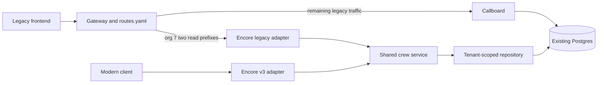

# Wave 1: crew reads, compatibility, and migration

Status: implemented Wave 1 design, reconciled with saved verification on
2026-10-24. Shared retrieval/v3 (`69438b9`) and legacy/gateway support
(`4ff8a3c`) are committed. [I1](../tasks/I1-integration-rehearsal.md)
(`05bd1c0`) records passing direct/ingress gates, actual org-7 cutover,
legacy-write visibility, config-only rollback and final mixed routing.
[Compact evidence](../investigation/evidence/i1-integration-20261024.jsonl)
retains both the failed host-publication attempt and corrected rehearsal.
R1 independently accepted the bounded local Wave 1 result. Remote CI execution
and required branch checks remain unverified release gates. This document
separates the implemented decisions, observed local evidence and remaining
limits.

## 1. Goal and boundary

Move `GET /callboard/crew/list` and `GET /callboard/crew/show` for **org 7** to
Encore, preserving the legacy frontend's observable behavior. Provide modern
`GET /v3/crew` and `GET /v3/crew/{crew_id}` from the same retrieval implementation.
Rollback of the two legacy paths must be a `proxy/routes.yaml` edit, without a
deploy, service restart, or reverse data migration.

Callboard retains all writes, scheduling, messaging, and its accelerated
maintenance job. Both backends use the existing Postgres `tg_crew` table. There
are no schema changes, copied tables, caches, new workers, or write handoffs.
This keeps the first wave feasible within the interview: two reads with strong
evidence, rather than a general migration platform.

The frozen corpus is evidence for tested behavior, not proof of complete
equivalence for every possible request. Discovery and additions continue through
public HTTP and database observation; the assessment excludes binary extraction
and reverse engineering.

## 2. Current evidence and gaps

The [brief](../README.md), [submission seam map](../SEAMS.md), and
[crew behavior notes](../investigation/LEGACY_CREW_BEHAVIOR.md) establish the
scope and contracts. Encore registers modern crew routes from
`encore/app/main.py` alongside `/healthz`, backed by crew models, repository, and
service modules. It also registers the `legacy.py` compatibility
adapter over the same service. See
[trade-offs](TRADEOFFS.md) for saved test results and remaining limits.
`proxy/app.py` rereads its route file per request, chooses the longest path
prefix, and matches org overrides using the **exact header string**.

Existing [characterization tests](../tests/characterization/README.md) contain
immutable raw responses and controlled fixture data. The
[verification runner](../tests/README.md) provisions an isolated Compose stack
inside the repo's test infrastructure; only runtime containers, network, and
database are disposable. Saved run counts below describe the I1 source snapshot,
not a permanent suite size; the compact evidence records source/corpus hashes.

Slice D/I1 resolved the following original gaps:

- The old `tests/routes.yaml` sent the whole crew prefix, for every org, to Encore.
  It has been replaced with explicit all-legacy and two-prefix/org-7 fixtures in
  `tests/routes/`, with an isolated shared route directory for atomic publication.
- Direct and gateway contracts differ today. The
  [gateway evidence](../investigation/evidence/gateway-boundary.jsonl) shows
  direct HEAD/OPTIONS responses differ from gateway 405 responses. The gateway
  replaces Host with its upstream destination, affecting absolute redirect URLs
  and HTML. Its trace and served-by headers also require explicit assertions.
  The additional original-gateway capture is retained with source provenance in
  [`slice-d-original-gateway-20261024.jsonl`](../investigation/evidence/slice-d-original-gateway-20261024.jsonl).

## 3. Request flow and code structure



Modules under `encore/app/crew/` (repository/service/v3 committed in slice B;
legacy implemented in slice C):

| Module | Responsibility |
| --- | --- |
| `repository.py` | Explicit safe column selection; bound SQL parameters; org-scoped list/detail queries; no HTTP decisions. |
| `service.py` | Shared retrieval, deterministic ID ordering, owned/not-found result; request-scoped session lifecycle. |
| `legacy.py` | Raw legacy parsing, route/method dispatch, precedence, pagination policy, exact errors and wire serialization. |
| `v3.py` | Modern validation, response models, HTTP errors, and documented pagination. |

`main.py` registers both adapters and retains existing `db.py`. A small typed
crew record carries stored values; adapters map it to their own response
models. The repository selects only `id`, `org`, `user_name`, `display_name`, `rate`, `is_lead`,
`notes`, and `prefs_blob`; never select or expose passwords.

Both adapters call the service directly, not one another over HTTP. Every detail
lookup includes both org and ID in its predicate. A foreign record and an absent
record produce the same not-found result. Do not fetch an unscoped record and
check tenancy afterward.

For this small assessment, list retrieval selects the tenant's ordered rows
once; each adapter applies its documented pagination to that result. This makes
total and page internally consistent for the request and naturally supports
legacy negative slicing. It costs O(tenant crew count) memory, acceptable for the
fixture scale; database pagination for large tenants is deferred and must retain
the contract. No snapshot or global-consistency guarantee across requests is
introduced. Each request reads current committed data without a cache.

## 4. Legacy compatibility adapter

Keep compatibility inside the legacy namespace; do not globally replace FastAPI
validation or error handling for `/v3` and `/healthz`. A small compatibility
dispatcher must control route recognition and response construction, including
wrong methods and suffixes. Ordinary automatic redirects, 404/405/422 responses,
and JSON encoders are insufficient.

Use the existing raw request transport in characterization tests. In the adapter,
inspect ASGI raw query bytes, raw path where necessary, and repeated headers
before framework accessors discard or normalize meaningful inputs. Preserve
first-query-value semantics and the observed handling of duplicate org headers;
do not use a dictionary that silently chooses the last value. Route/method checks
and org/parameter validation must follow the precedence recorded in the corpus.

| Concern | Required legacy behavior |
| --- | --- |
| Tenant/header parsing | Missing and many malformed orgs yield HTTP-200 `missing org`; some unusual numeric forms have distinct errors. Org failure precedes bad page/ID. Query/body org does not override the header. |
| Pagination | Missing/empty defaults to page 1, size 25; page ≤0 becomes 1. Python integer forms, zero-size all-rows behavior, and negative slicing are preserved. Parse page before size. |
| Detail IDs | Preserve PostgreSQL 16 integer conversion: signed/padded, underscore, hex/octal/binary, range failures, and Unicode-digit rejection differ from pagination. |
| Values | `user_name` becomes `crew_name`; rate has two decimal places or `""` for null; only uppercase `Y` is lead. Null notes/preferences become `""`; nullable display name remains null. Detail returns raw preferences text; list omits it. |
| Wire output | Match envelope, field order, escaping, compact separators, final newline, content type, relevant headers, and HTTP-200 application failures. |
| Paths/methods | Preserve captured encoded-route handling, 308 double-slash HTML redirects, trailing/suffix 404 bodies, wrong-method 405 bodies, and direct HEAD/OPTIONS behavior. |

Pass the raw ID as a **bound text parameter** to a PostgreSQL integer cast within
the tenant-scoped lookup; never concatenate input into SQL or pre-coerce it with
Python `int()`. A repository conversion failure must roll back/close its session.
Map known parser/driver failures in the legacy adapter to the frozen error text,
including captured context, rather than exposing SQLAlchemy's incidental wrapper
message or SQL statement. Handle decoded NUL explicitly if the driver rejects it
before PostgreSQL does. `/v3` must not disclose these database diagnostics.

Redirect comparisons do not follow Location. Given identical Host input, direct
Encore reproduces the captured direct legacy response. At ingress the existing
gateway boundary remains unchanged: double-slash paths stay on Callboard because
they do not match the two migrated prefixes; selected suffixes return compatible
404 failure bodies. Tests cover the observed redirect Location/HTML separately
from direct-backend goldens.

The original design considered supplying the legacy upstream Host if a migrated
request exposed redirect-host drift. Slice D found no such selected redirect,
so that conditional adjustment was not implemented. Gateway forwarding still
uses first-header route selection, last-header forwarding and its observed query
normalization. No response-body rewrite or oracle regeneration was introduced.

## 5. Implemented modern contract

The modern API intentionally differs from the wrapper. These choices are
implemented and documented in OpenAPI and tests:

- `X-Org-Id` is a required, single, positive ASCII decimal integer within the
  database integer range. Reject duplicate headers and malformed values with 422.
  This assessment header is trusted tenant context, not a new authentication system.
- `GET /v3/crew?page=1&page_size=25`: positive page; size 1–100; strict ASCII
  decimal inputs. Duplicate recognized parameters and unknown parameters return
  422. Return `{"items": [...], "page": 1, "page_size": 25, "total": N}` with
  ascending ID order; an empty or out-of-range page is 200 with an empty list.
- `GET /v3/crew/{crew_id}`: positive ASCII decimal integer within the database
  range. Invalid ID is 422; missing/foreign crew is 404 with a common
  `{"detail":"Crew not found"}` body. Unknown detail query parameters return 422.
- List items and detail expose `id`, `org_id`, `user_name`, `display_name`, `rate`,
  `is_lead`, and `notes`; detail also exposes `preferences_raw`. Preserve stored
  nulls. Rate is a nullable two-decimal string, avoiding floating-point money;
  lead is a boolean true only for stored uppercase `Y`. Preferences remain
  nullable raw text because the table contains invalid JSON. Do not silently
  repair them or promise that `user_name` is always an email.
- GET succeeds with 200 JSON. Unsupported methods use standard 405; disable
  slash redirects for these routes and return 404 for trailing-slash variants.
  Standard 422 validation details are documented separately from legacy errors.

No filters, search, writes, cursor pagination or preferences schema were added.
Modern clients use Encore directly on port 8092. The current gateway deliberately
has no `/v3` override and would fall back to unsupported Callboard paths; adding
gateway access would require a separately reviewed route. Legacy rollback never
redirects modern traffic to Callboard.

## 6. Implementation slices and verification

Use pytest for execution/fixtures/reporting, HTTPX for normal HTTP tests, the
existing raw transport for malformed requests, Hypothesis for bounded exploration,
and Compose for orchestration. No custom test framework is needed.

| Slice | Implemented deliverable and gate |
| --- | --- |
| A. Preserve reference | Frozen direct corpora retain their pre-port hashes; additions come from Callboard observation. |
| B. Shared reads and modern API | Repository/service/v3 adapters share tenant-scoped retrieval, with unit and modern HTTP coverage. |
| C. Legacy wrapper | Both direct backends pass the unchanged corpus; focused parser/serializer tests supplement wire comparisons. |
| D. Gateway and mixed state | Ingress baseline, canonical org-7 routing, HTTP-write visibility and rollback pass in the isolated gate and I1 deployment rehearsal. |
| E. Gate and evidence | Named automatic CI jobs and saved local matrix/evidence are implemented. R1 accepts the bounded local result; remote execution/enforcement remain unverified release gates. |

Current commands, from the repo root:

```sh
python3 scripts/verify --backend legacy
python3 scripts/verify --backend encore
python3 scripts/verify --backend both
python3 scripts/verify --backend gateway
```

These are implemented entry points. The direct targets retain the unchanged
golden comparisons. Gateway mode runs unit, ingress/mixed-routing, smoke, and
direct-modern tests at its separate boundary. It captures fresh Callboard ingress
responses before cutover and compares the same requests after atomic publication
of `tests/routes/mixed-org7.yaml`, using `tests/routes/legacy.yaml` for baseline
and rollback. Original ingress observations pin the gateway-specific quirks.
Comparisons exclude volatile transport fields, compare Allow as a method set,
control trace input, and require the intended served-by value. Gateway-generated
HEAD/OPTIONS 405 responses retain their absence of upstream markers. A redirected
or fallback request must not masquerade as an Encore success.

The isolated ingress scenario installs owned reserved-tenant fixtures and captures
an all-Callboard baseline before switching the two org-7 prefixes. It sends a
controlled notes update through legacy HTTP, verifies the exact persisted delta,
checks wrapper and modern list/detail visibility, restores the value in cleanup,
and checks rollback without changing the gateway instance. Earlier SQL-only
committed-update coverage remains useful but is no longer the only visibility
proof. Fixtures reset between scenarios/backends. Read invariants compare crew
globally and other tables for owned fixture orgs; seeded scheduling may change
under legacy maintenance, so globally quiescent state is not claimed.

[I1](../tasks/I1-integration-rehearsal.md) records one complete combined run:
legacy and Encore each passed 1,084 pytest tests (JUnit suite count 1,097, including
13 unittest subtest increments); gateway passed 81. All three exited 0 with no
failures/errors/skips. The compact evidence identifies the exact projects and
source/corpus hashes; raw local reports contain JUnit and service logs. These are
saved I1 results, not new tests run during this document reconciliation.

The [workflow](../.github/workflows/verify.yml) automatically runs PRs targeting
`main` and pushes to `main` with checks **Direct legacy and modern**, **Direct
Encore and modern**, and **Gateway ingress and mixed routing**. Modern tests
remain in each job. `fail-fast: false` lets all jobs report, command failures set
job status, and `always()` uploads backend/run/attempt-qualified evidence. Manual
runs retain the backend selector, including sequential `both`.

Workflow configuration does not prove GitHub execution/upload or enforcement.
Remote branch rules must require all three named checks and PRs; this work did
not configure or verify those rules. Reduced pytest selections are investigation,
not full release evidence.

## 7. Migration and rollback runbook

The current `proxy/routes.yaml` already contains the mixed target below. Follow
the concrete [D2 commands](../tasks/D2-rollout-configuration.md) when rehearsing
from all-legacy routing or rolling back; preserve any subsequently added unrelated
rules. The sequence below describes both the dependency order and I1's saved
completed rehearsal, not a request to repeat it on the running stack.

1. **Prepare:** build/health-check Encore and run full gates on fresh test DBs.
   The gateway uses `./proxy:/srv/routes:ro` and
   `ROUTES_FILE=/srv/routes/routes.yaml`. I1 prepared that directory mount/current
   gateway image with one gateway-only recreation while routing remained legacy;
   DB, Callboard and Encore containers were preserved. Save original route bytes,
   baseline responses, container identity and the post-preparation `instance_id`.
2. **Rehearse:** isolated ingress checks cover canonical/padded orgs, duplicates,
   encoded paths, suffixes, methods, redirects and tenant boundaries. I1 then
   exercised the actual development stack and observed the publication issue
   described below before accepting the corrected rehearsal.
3. **Cut over:** use D2's `publish_d2_routes tests/routes/mixed-org7.yaml`.
   The function starts a disposable container from the cached gateway image,
   validates candidate bytes, writes/fsyncs a temporary file in the route
   directory and atomically replaces the target from the Linux filesystem view.
   Only that helper has the route directory writable; the gateway remains
   read-only. Modern callers remain direct on 8092; no `/v3` route is added.

```yaml
routes:
  "/callboard/":
    default: callboard
  "/callboard/crew/list":
    default: callboard
    orgs:
      "7": encore
  "/callboard/crew/show":
    default: callboard
    orgs:
      "7": encore
```

4. **Verify:** require canonical org-7 reads to be Encore-served and nonmigrated
   traffic to remain Callboard-served. Compare status/body/relevant headers with
   the ingress baseline, including HTTP-200 failures, rather than status alone.
   Verify one guarded legacy HTTP notes update, its DB delta and immediate
   wrapper/v3 visibility, then restore the exact original value. Record response,
   scoped DB and process-identity evidence.
5. **Rollback on drift:** run `publish_d2_routes tests/routes/legacy.yaml`, or
   publish the saved original file for exact byte restoration. Repeat both
   list/detail comparisons and require the same gateway container/start time,
   restart count and `instance_id`. Do not rebuild/restart between cutover and
   rollback. I1 demonstrated this rollback and then reapplied the mixed fixture,
   which remains the final committed target. Modern traffic stays direct Encore;
   an outage there needs its own fix or client suspension.

Rules match prefixes, not methods/exact paths: org-7 `list/extra` also selects
Encore and returns its compatible failure, while crew/update stays Callboard.
Canonical header string `7` differs from `07`; preserve that existing routing
boundary. A directory mount avoids the old single-file stale-inode hazard, but
it does not guarantee coherent host/VM publication on every runtime.

I1's original **host-side** atomic rename produced **28 HTTP 500 responses** on
this Colima share because the gateway briefly saw no route file; no HTTP write
was attempted. The attempt and recovery are retained, not counted as successful
zero-disruption evidence. The corrected Linux-view publisher passed 6,319
concurrent temporary-directory reads and the real cutover → rollback → final
mixed reapply. Across that corrected rehearsal, 58 continuous public crew-list
samples returned HTTP 200/`result: ok`; gateway identity stayed unchanged and the
original crew state was restored and schema stayed unchanged. This is bounded
sampled evidence,
not proof for every interleaving or filesystem.

Use the Linux-view publisher for this deployment instead of host-side rename or
in-place truncation. It validates before publication, preserves permissions and
owner, has no network access and removes itself after execution. There is still
no gateway last-known-good config fallback; a valid candidate and the saved
rollback path remain operational requirements. Exact command/code and artifact
references are in D2 and the compact I1 evidence.

## 8. Acceptance, risks, and deferred work

The local technical acceptance evidence now covers the unchanged direct corpus
on both backends, the deliberate v3 contract, ingress/mixed routing, immediate
legacy HTTP-write visibility, read-side DB checks and config-only rollback.
R1 independently accepted this bounded local technical result. Remote CI
execution and required-check enforcement are unverified release gates. Known
limits and intentional modern differences are recorded in [scoping](SCOPING.md)
and [trade-offs](TRADEOFFS.md).

Principal risks are raw HTTP normalization, leaked driver error text, accidental
tenant omission, broad prefix cutover, and false confidence from a green legacy
run. Address them with the adapter boundary and explicit gates above. DB
availability remains shared; routing rollback cannot repair a shared DB outage.
Concurrent mutations across requests remain uncharacterized; the single-query
list design supplies request-local page/total consistency. Parser coverage is
bounded evidence, not an exhaustive guarantee.

Scheduling invariants, expiry cutoffs, digest eligibility, concurrency, event
delivery, production authentication, and transferring writes/jobs are later-wave
work. Config routing changes HTTP ownership only; it does not disable legacy
maintenance. Later write migrations will need transaction and job ownership
designs: changing a route cannot undo data changes or sent notifications.
