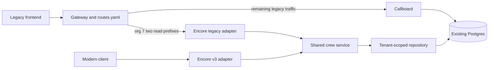

# Wave 1: crew reads, compatibility, and migration

Status: proposed implementation design, 2026-10-24. This document specifies work;
it does not claim Encore compatibility or customer cutover is complete.

## 1. Goal and boundary

Move `GET /callboard/crew/list` and `GET /callboard/crew/show` for **org 7** to
Encore, preserving the legacy frontend's observable behavior. Provide modern
`GET /v3/crew` and `GET /v3/crew/{crew_id}` from the same retrieval implementation.
Rollback of the two legacy paths must be a `proxy/routes.yaml` edit, without a
deploy, service restart, or reverse data migration.

Callboard retains all writes, scheduling, messaging, and its accelerated
maintenance job. Both backends use the existing Postgres `tg_crew` table. There
are no schema changes, copied tables, caches, new workers, or write handoffs.
This keeps the first wave feasible within the interview: two reads with strong
evidence, rather than a general migration platform.

The frozen corpus is evidence for tested behavior, not proof of complete
equivalence for every possible request. Discovery and additions continue through
public HTTP and database observation; the assessment excludes binary extraction
and reverse engineering.

## 2. Current evidence and gaps

The [brief](../README.md), [seam map](../SEAMS.md), and
[crew behavior notes](../investigation/LEGACY_CREW_BEHAVIOR.md) establish the
scope and contracts. `encore/app/main.py` currently exposes only `/healthz`.
`proxy/app.py` rereads its route file per request, chooses the longest path
prefix, and matches org overrides using the **exact header string**.

Existing [characterization tests](../tests/characterization/README.md) contain
immutable raw responses and controlled fixture data. The
[verification runner](../tests/README.md) provisions an isolated Compose stack
inside the repo's test infrastructure; only runtime containers, network, and
database are disposable. Do not freeze a test count here because another
investigation may append cases. At implementation time record the corpus revision
and checksum alongside each run.

Two gaps matter before cutover:

- `tests/routes.yaml` sends the whole crew prefix, for every org, to Encore. That
  intentionally exercises fixture orgs but does not establish safe org-7 routing.
- Direct and gateway contracts differ today. The
  [gateway evidence](../investigation/evidence/gateway-boundary.jsonl) shows
  direct HEAD/OPTIONS responses differ from gateway 405 responses. The gateway
  replaces Host with its upstream destination, affecting absolute redirect URLs
  and HTML. Its trace and served-by headers also require explicit assertions.

## 3. Request flow and code structure



Proposed additions under `encore/app/crew/`:

| Module | Responsibility |
| --- | --- |
| `repository.py` | Explicit safe column selection; bound SQL parameters; org-scoped list/detail queries; no HTTP decisions. |
| `service.py` | Shared retrieval, deterministic ID ordering, owned/not-found result; request-scoped session lifecycle. |
| `legacy.py` | Raw legacy parsing, route/method dispatch, precedence, pagination policy, exact errors and wire serialization. |
| `v3.py` | Modern validation, response models, HTTP errors, and documented pagination. |

Register these adapters from `main.py`, retaining existing `db.py`. Keep a small
typed crew record carrying stored values; adapters map it to their own response
models. Select only `id`, `org`, `user_name`, `display_name`, `rate`, `is_lead`,
`notes`, and `prefs_blob`; never select or expose passwords.

Both adapters call the service directly, not one another over HTTP. Every detail
lookup includes both org and ID in its predicate. A foreign record and an absent
record produce the same not-found result. Do not fetch an unscoped record and
check tenancy afterward.

For this small assessment, list retrieval can select the tenant's ordered rows
once; each adapter applies its documented pagination to that result. This makes
total and page internally consistent for the request and naturally supports
legacy negative slicing. It costs O(tenant crew count) memory, acceptable for the
fixture scale; database pagination for large tenants is deferred and must retain
the contract. No snapshot or global-consistency guarantee across requests is
introduced. Each request reads current committed data without a cache.

## 4. Legacy compatibility adapter

Keep compatibility inside the legacy namespace; do not globally replace FastAPI
validation or error handling for `/v3` and `/healthz`. A small compatibility
dispatcher must control route recognition and response construction, including
wrong methods and suffixes. Ordinary automatic redirects, 404/405/422 responses,
and JSON encoders are insufficient.

Use the existing raw request transport in characterization tests. In the adapter,
inspect ASGI raw query bytes, raw path where necessary, and repeated headers
before framework accessors discard or normalize meaningful inputs. Preserve
first-query-value semantics and the observed handling of duplicate org headers;
do not use a dictionary that silently chooses the last value. Route/method checks
and org/parameter validation must follow the precedence recorded in the corpus.

| Concern | Required legacy behavior |
| --- | --- |
| Tenant/header parsing | Missing and many malformed orgs yield HTTP-200 `missing org`; some unusual numeric forms have distinct errors. Org failure precedes bad page/ID. Query/body org does not override the header. |
| Pagination | Missing/empty defaults to page 1, size 25; page ≤0 becomes 1. Python integer forms, zero-size all-rows behavior, and negative slicing are preserved. Parse page before size. |
| Detail IDs | Preserve PostgreSQL 16 integer conversion: signed/padded, underscore, hex/octal/binary, range failures, and Unicode-digit rejection differ from pagination. |
| Values | `user_name` becomes `crew_name`; rate has two decimal places or `""` for null; only uppercase `Y` is lead. Null notes/preferences become `""`; nullable display name remains null. Detail returns raw preferences text; list omits it. |
| Wire output | Match envelope, field order, escaping, compact separators, final newline, content type, relevant headers, and HTTP-200 application failures. |
| Paths/methods | Preserve captured encoded-route handling, 308 double-slash HTML redirects, trailing/suffix 404 bodies, wrong-method 405 bodies, and direct HEAD/OPTIONS behavior. |

Pass the raw ID as a **bound text parameter** to a PostgreSQL integer cast within
the tenant-scoped lookup; never concatenate input into SQL or pre-coerce it with
Python `int()`. A repository conversion failure must roll back/close its session.
Map known parser/driver failures in the legacy adapter to the frozen error text,
including captured context, rather than exposing SQLAlchemy's incidental wrapper
message or SQL statement. Handle decoded NUL explicitly if the driver rejects it
before PostgreSQL does. `/v3` must not disclose these database diagnostics.

Compare redirects without following them. Given identical Host input, direct
Encore must reproduce the direct legacy response. At ingress, retain the
existing gateway behavior rather than incidentally fixing it in this wave.
The actual double-slash path remains on Callboard because it does not match the
two configured prefixes; assert that fact. Where ingress comparison demonstrates
redirect-host drift for requests selected for Encore's legacy wrappers, the
chosen narrow gateway fix is to supply the legacy upstream Host (derived from
`CALLBOARD_URL`), retaining the old absolute Location and HTML. Test this forwarding
behavior explicitly; leave direct Encore's supplied Host and v3 forwarding
unchanged. Do not broadly rewrite response bodies or excuse differences by
updating the oracle.

## 5. Proposed modern contract

The modern API intentionally differs from the wrapper. Document these choices
in OpenAPI and tests before implementation:

- `X-Org-Id` is a required, single, positive ASCII decimal integer within the
  database integer range. Reject duplicate headers and malformed values with 422.
  This assessment header is trusted tenant context, not a new authentication system.
- `GET /v3/crew?page=1&page_size=25`: positive page; size 1–100; strict ASCII
  decimal inputs. Duplicate recognized parameters and unknown parameters return
  422. Return `{"items": [...], "page": 1, "page_size": 25, "total": N}` with
  ascending ID order; an empty or out-of-range page is 200 with an empty list.
- `GET /v3/crew/{crew_id}`: positive ASCII decimal integer within the database
  range. Invalid ID is 422; missing/foreign crew is 404 with a common
  `{"detail":"Crew not found"}` body. Unknown detail query parameters return 422.
- List items and detail expose `id`, `org_id`, `user_name`, `display_name`, `rate`,
  `is_lead`, and `notes`; detail also exposes `preferences_raw`. Preserve stored
  nulls. Rate is a nullable two-decimal string, avoiding floating-point money;
  lead is a boolean true only for stored uppercase `Y`. Preferences remain
  nullable raw text because the table contains invalid JSON. Do not silently
  repair them or promise that `user_name` is always an email.
- GET succeeds with 200 JSON. Unsupported methods use standard 405; disable
  slash redirects for these routes and return 404 for trailing-slash variants.
  Standard 422 validation details are documented separately from legacy errors.

No new filters, search, writes, cursor pagination, or preferences schema are needed.
If clients reach `/v3` through the gateway, explicitly route `/v3/crew` to Encore;
the current fallback would otherwise send it to unsupported Callboard paths.

## 6. Implementation slices and verification

Use pytest for execution/fixtures/reporting, HTTPX for normal HTTP tests, the
existing raw transport for malformed requests, Hypothesis for bounded exploration,
and Compose for orchestration. No custom test framework is needed.

| Slice | Deliverable and gate |
| --- | --- |
| A. Preserve reference | Run legacy verification; record fixture/corpus checksums. Add missing named discoveries only from Callboard observations, never Encore-generated expectations. |
| B. Shared reads and modern API | Implement repository/service plus v3 adapters. Unit-test tenant predicates and modern validation; e2e-test modern list/detail, nulls, ordering, errors, and no secret exposure. |
| C. Legacy wrapper | Replay the unchanged complete corpus against Encore. Add targeted unit tests only for tricky parsing/serialization; keep end-to-end wire checks authoritative. |
| D. Gateway and mixed state | Add an ingress baseline against all-legacy routing, compare after actual org-7 cutover, and verify served-by decisions, legacy-write visibility, and rollback. |
| E. Required gate and evidence | Run full matrix, retain JUnit/logs/diffs, update submission writeups, and require checks before main. |

Current commands, from the repo root:

```sh
python3 scripts/verify --backend legacy
python3 scripts/verify --backend encore
python3 scripts/verify --backend gateway
```

These are implemented entry points, but currently Encore lacks wrappers and the
gateway mode applies the direct corpus to a different boundary. Slice D must
make gateway verification boundary-aware: keep direct golden comparisons
unchanged and compare gateway responses against independently observed ingress
expectations. Exclude volatile transport fields, compare Allow as a method set,
control trace input, and require the intended served-by value. A redirected or
fallback request must not masquerade as an Encore success. Add a committed mixed
route fixture and isolated test scenario to this runner; its invocation/interface
is implementation work, not an existing command claimed by this design.

In the isolated stack, exercise org 7 reads through the gateway; keep other orgs,
crew/update, scheduling, and messaging on Callboard. Safely update an owned crew
through legacy HTTP, assert its persisted field, then assert the next Encore
list/detail and v3 read reflect it. The current committed-update test uses SQL,
so it does not replace this HTTP writer test. Reset fixture state between
scenarios/backends. Assert crew globally and other tables for owned test orgs
are unchanged by reads; unrelated maintenance may legitimately change seeded
scheduling data. Do not claim globally quiescent state.

CI currently runs only the legacy command automatically. Add separately named
legacy, Encore, gateway-ingress/mixed, and
modern checks after they pass; require them for PRs targeting main. Workflow YAML
alone is insufficient: configure GitHub branch protection/rulesets to require
checks and PRs. A reduced pytest selection is investigation, not release evidence.

## 7. Migration and rollback runbook

1. **Prepare:** start the stack with the completed Encore image/source; keep all
   legacy routes on Callboard. Confirm DB/HTTP health and full verification on
   fresh test databases. Before this rollout, change the gateway's single-file
   bind mount to a read-only containing-directory mount and point `ROUTES_FILE`
   at its route file; deploy/restart that setup once while routing remains legacy.
   Save the previous route file and current ingress results.
2. **Rehearse:** run the actual mixed configuration and route-file-only rollback
   in the isolated stack. Include canonical and padded org headers, duplicate
   headers, encoded paths, suffixes, methods, redirects, and cross-org IDs.
3. **Cut over:** apply this proposed target YAML to `proxy/routes.yaml`, preserving
   reviewed unrelated rules. The `/v3/crew` rule is optional if modern clients use
   Encore directly. The gateway reads the file on the next request.

```yaml
routes:
  "/callboard/":
    default: callboard
  "/callboard/crew/list":
    default: callboard
    orgs:
      "7": encore
  "/callboard/crew/show":
    default: callboard
    orgs:
      "7": encore
  "/v3/crew":
    default: encore
```

4. **Verify:** canonical `X-Org-Id: 7` crew reads report `X-Served-By: encore`;
   nonmigrated paths/orgs report `callboard`. Compare status, body and relevant
   headers with the ingress baseline, not only HTTP success. Check HTTP-200
   `result: fail` bodies, service logs/trace IDs, tenant isolation, and a legacy
   update followed by an Encore read. Record the report location and config diff.
5. **Rollback on drift:** change the two `"7": encore` values to
   `"7": callboard`, leaving their legacy defaults intact. Validate YAML, save,
   and repeat routing and response checks without restarting anything. Keep the
   legacy rollback independent of the optional `/v3/crew` route: Callboard cannot
   serve v3. A modern API outage needs its own fix or client suspension.

Rules are prefixes, not method/exact-path rules. Thus `list/extra` routes to Encore
for org 7 and must return the compatible error; crew/update stays legacy. Exact
org strings mean `07` or padded `7` may still reach Callboard even where the
legacy parser considers them org 7. Preserve this existing behavior. Validate a
candidate YAML file, then publish it by atomic rename in the mounted directory
for both cutover and rollback; confirm a live routing change. The preparation
above matters: the current single-file mount can retain a stale inode after an
atomic replacement, while an in-place write exposes partial YAML to requests.
There is no existing last-known-good fallback. The directory mount and atomic
publish address these hazards without a watcher or a restart during cutover.

## 8. Acceptance, risks, and deferred work

Wave 1 is accepted only when the unchanged direct corpus passes against both
backends; v3 matches its documented contract; ingress and actual mixed-routing
checks pass; a legacy HTTP update is visible on the next Encore read; read-side
DB checks pass; and config-only rollback is demonstrated with evidence. Record
known limits and intentional modern differences in `SCOPING.md`/`TRADEOFFS.md`.

Principal risks are raw HTTP normalization, leaked driver error text, accidental
tenant omission, broad prefix cutover, and false confidence from a green legacy
run. Address them with the adapter boundary and explicit gates above. DB
availability remains shared; routing rollback cannot repair a shared DB outage.
Concurrent mutations across requests remain uncharacterized; the single-query
list design supplies request-local page/total consistency. Parser coverage is
bounded evidence, not an exhaustive guarantee.

Scheduling invariants, expiry cutoffs, digest eligibility, concurrency, event
delivery, production authentication, and transferring writes/jobs are later-wave
work. Config routing changes HTTP ownership only; it does not disable legacy
maintenance. Later write migrations will need transaction and job ownership
designs: changing a route cannot undo data changes or sent notifications.
